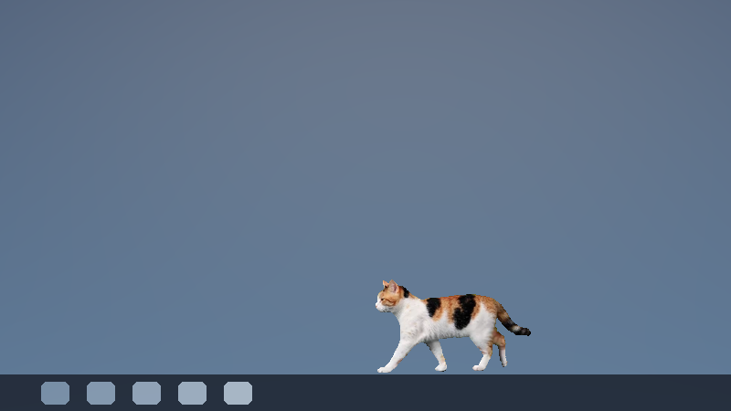
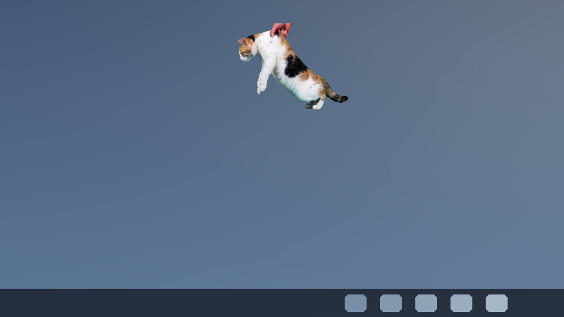

<div align="center">

# 🐱 Calico Cat — a realistic calico cat for your desktop

**English** · [Tiếng Việt](README.vi.md)

Version 1.0.0 · [Release notes](https://github.com/tunv201298/calico-cat/releases) · [Download](https://github.com/tunv201298/calico-cat/releases/latest) · [▶ Intro video](docs/video/calico-cat-intro.mp4)


A lifelike calico cat that lives at the bottom of your screen: it walks around, sits, grooms,
chases butterflies, plays with yarn, naps — and reacts when you pet it, pick it up or call it
from the menu. Every animation is cut from real (AI-generated) video, so it moves like a real cat.

</div>

---

## Contents

- [Features](#features)
- [Screenshots and video](#screenshots-and-video)
- [Supported systems](#supported-systems)
- [Installation](#installation)
- [First launch](#first-launch)
- [Usage](#usage)
- [Settings](#settings)
- [Known limitations](#known-limitations)
- [Troubleshooting](#troubleshooting)
- [Uninstall](#uninstall)

## Features

- **Real-video animation** — walk cycle, sitting down, standing up, turning around, grooming,
  stretching, chasing its tail, catching butterflies, playing with yarn, sleeping. Smooth 24–48
  frames per second with seamless transitions between poses; paws never slide on the ground.
- **Lives on its own** — picks a random activity every few seconds, never in the same order twice.
- **Interactive** — click to pet, double-click to make it jump, drag to pick it up by the scruff,
  drop it and it lands on its feet.
- **Stays out of your way** — only 51 px tall by default (three sizes), always on top or behind
  your windows as you prefer.
- **10 languages** — English (default), Tiếng Việt, 日本語, 中文, 한국어, Español, Français, Deutsch,
  Português, Русский. Speech bubbles can be turned off.
- **Real cat sounds** — meows, purrs and chirps at a soft, even volume, adjustable or muted.
- **Offline and private** — no network access; settings stay on your computer.

## Screenshots and video

**[▶ Watch the intro video](docs/video/calico-cat-intro.mp4)** (2 min, with sound) — every activity of the real app, one after another.

<table>
<tr><td align="center" width="33%"><br>Says hello</td><td align="center" width="33%"><br>Walks around</td><td align="center" width="33%"><br>Chases butterflies</td></tr>
<tr><td align="center" width="33%"><br>Click to pet</td><td align="center" width="33%"><br>Plays with yarn</td><td align="center" width="33%"><br>Drag to pick it up</td></tr>
<tr><td align="center" width="33%"><br>Stretches and yawns</td><td align="center" width="33%"><br>Takes naps</td><td align="center" width="33%"><br>Right-click menu</td></tr>
</table>

## Supported systems

| System | Download | Notes |
|---|---|---|
| Windows 10 / 11 (64-bit) | `CalicoCat-<version>-Setup.exe` | The cat's outline is slightly jagged (see [Known limitations](#known-limitations)). |
| Ubuntu 22.04 or newer, Debian-based distributions (64-bit) | `calico-cat_<version>_amd64.deb` | Works on X11 and on Wayland (GNOME, KDE). |
| macOS 12 or newer, Apple Silicon (**beta**) | `CalicoCat-<version>-macOS.dmg` | Not yet tested on a real Mac. |

## Installation

Download the file for your system from the [latest release](https://github.com/tunv201298/calico-cat/releases/latest).

### Windows

1. Run **`CalicoCat-<version>-Setup.exe`**. It installs for your user account only — no
   administrator rights needed (choose "all users" in the first dialog if you prefer).
2. Leave **Launch Calico Cat** ticked on the last page, or start **Calico Cat** from the Start menu later.

Windows SmartScreen may warn about an unknown publisher because the installer is not code-signed:
click **More info → Run anyway**.

### Ubuntu / Debian

Double-click the `.deb` file to install it with App Center, or run:

```bash
sudo apt install ./calico-cat_<version>_amd64.deb
```

Start **Calico Cat** from the applications menu.

### macOS (beta)

1. Open **`CalicoCat-<version>-macOS.dmg`** and drag **Calico Cat** into *Applications*.
2. The app is not signed by Apple, so the first launch is blocked: open *System Settings → Privacy &
   Security* and click **Open Anyway** next to Calico Cat.

## First launch

The first time Calico Cat starts, a settings window opens before the cat appears:

| Option | Choices |
|---|---|
| Language | English (default) and 9 other languages — the window switches language as soon as you pick one |
| Size | Small 51 px (default) · Medium 70 px · Large 106 px |
| Volume | 0 – 100% (default 50%); release the slider to hear a sample meow |
| Show speech bubbles | On (default) / off |
| Always on top of other windows | On (default) / off |
| Start with Windows | Off (default) / on — Windows only |

Click **OK** to save. Closing the window keeps the defaults. You can open it again any time:
right-click the cat → **⚙ Settings…**

## Usage

The cat appears in the bottom-right corner and starts living its life after a few seconds.

### Interacting with the cat

| Action | What happens |
|---|---|
| **Click** | Pet the cat — hearts float up, it meows and purrs, and its affection grows ❤ |
| **Double-click** | The cat jumps |
| **Click and drag** | Pick the cat up by the scruff — it dangles and swings under your cursor |
| **Release while holding** | The cat drops back to the ground and lands with a little bounce |
| **Click while it sleeps** | Wakes it up |
| **Right-click** | Opens the menu |

### Menu

| Item | Description |
|---|---|
| ✖ Close menu | Closes the menu (clicking anywhere outside it works too) |
| 💕 Pet · 🐟 Feed fish | Pet or feed the cat (both increase affection) |
| 🧼 Groom · 🦋 Catch butterfly · 🧶 Play with yarn · 🌀 Chase tail · 🥱 Stretch · 👀 Look around · 🔄 Turn around | Start an activity right away |
| 🐭 Chase the mouse pointer | The cat follows your cursor for a few seconds |
| 😴 Sleep / Wake up | Puts the cat to sleep or wakes it up |
| 📏 Size | Small 51 px · Medium 70 px · Large 106 px |
| 🌐 Language | Language of the speech bubbles and the menu |
| 💬 Speech bubbles | Show or hide what the cat says |
| 🔊 Volume | Off · 25% · 50% · 75% · 100% for the cat sounds (meow, purr, trill, chatter, yawn…) |
| 📌 Always on top | Keep the cat above other windows, or let windows cover it |
| 🚀 Start with Windows | Launch automatically when you sign in (Windows only) |
| 🏠 Back to the corner | Moves the cat back to the bottom-right corner |
| ⚙ Settings… | Opens the settings window to change several options at once |
| ❤ Affection | How much the cat likes you (read-only) |
| ❌ Goodbye | Quit |

### What the cat does on its own

| Activity | Share | Description |
|---|---|---|
| 🚶 Walk | 32% | Stands up, walks for 6–14 s, sits down. Often turns around first; near the screen edge it stops, looks back and walks the other way |
| 🪑 Sit | 13% | Rests and sometimes says something |
| 🧼 Groom | 11% | Licks its paw and washes its face |
| 🧶 Yarn | 9% | Pats, hugs and kicks a ball of yarn |
| 🦋 Butterfly | 7% | A butterfly flutters in; the cat stalks it and leaps — and just misses |
| 🥱 Stretch | 7% | Long stretch followed by a big yawn |
| 👀 Look around | 7% | Looks back over its shoulder |
| 🌀 Chase tail | 6% | Spins after its tail and gets dizzy |
| 😴 Sleep | 6% | Curls up and breathes slowly until you wake it |

## Settings

Every change from the menu or the settings window is saved right away and kept for the next
launch. Settings are stored in the `.calico_cat` folder in your home folder
(Windows: `C:\Users\<you>\.calico_cat`); delete that folder to reset everything and see the
first-launch window again.

The language item always also reads "Language", so you can find it even in a language you cannot read.

### Start automatically on Ubuntu

The **Start with Windows** option exists only on Windows. On Ubuntu, run once:

```bash
mkdir -p ~/.config/autostart && cp /usr/share/applications/calico-cat.desktop ~/.config/autostart/
```

To stop it, delete `~/.config/autostart/calico-cat.desktop`.

## Known limitations

- **Memory** — animations stay in memory so the cat reacts instantly: about 110 MB at Small size
  and about 410 MB at Large.
- **Windows** — transparency is on/off per pixel, so the cat's outline is slightly jagged instead
  of anti-aliased.
- **Ubuntu** — while the menu is open, a click outside it only closes the menu and does not reach
  the window below.
- **Multiple monitors** — the cat walks along the bottom edge of the whole virtual screen.

## Troubleshooting

| Problem | Solution |
|---|---|
| Windows: SmartScreen blocks the installer | Click **More info → Run anyway** (the installer is not code-signed) |
| macOS: "Calico Cat cannot be opened" | *System Settings → Privacy & Security* → **Open Anyway** |
| Ubuntu: the cat does not appear | Make sure you are in a normal desktop session (GNOME, KDE…); on Wayland, XWayland must be available (it is by default) |
| The cat is hidden behind windows | Menu → 📌 Always on top |
| The cat is too big or too small | Menu → 📏 Size |
| No sound | Menu → 🔊 Volume, and check your system volume |
| The cat got lost off-screen | Menu → 🏠 Back to the corner, or delete the `.calico_cat` folder |

Found a bug or have an idea? [Open an issue](https://github.com/tunv201298/calico-cat/issues).

## Uninstall

1. Ubuntu only: delete `~/.config/autostart/calico-cat.desktop` if you created it (on Windows the
   uninstaller also removes the start-up entry).
2. Uninstall from *Settings → Apps* (Windows), with `sudo apt remove calico-cat` (Ubuntu), or by
   moving Calico Cat from *Applications* to the Trash (macOS).
3. Delete the `.calico_cat` folder in your home folder.
