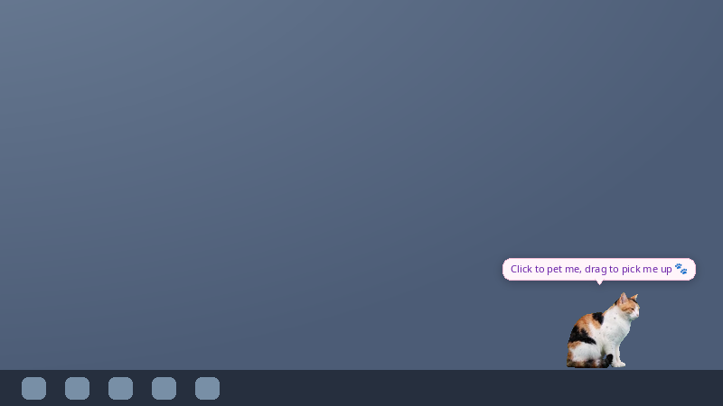
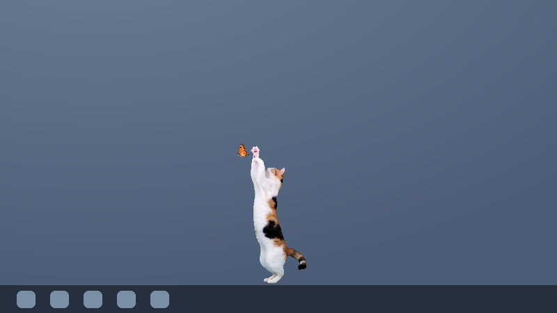
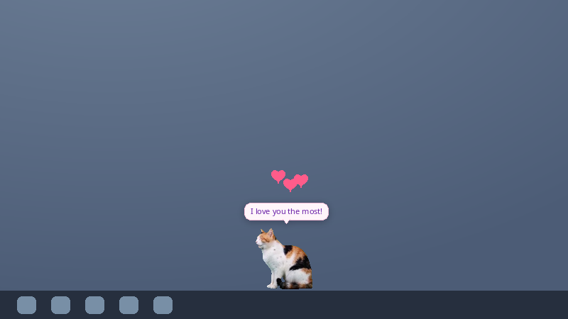
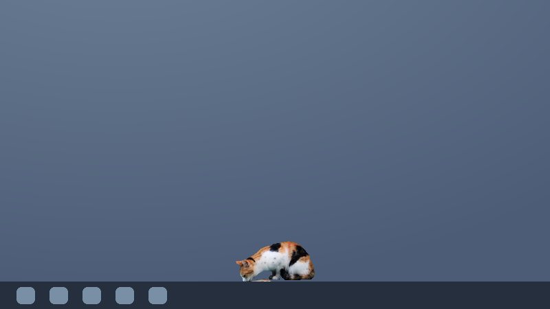
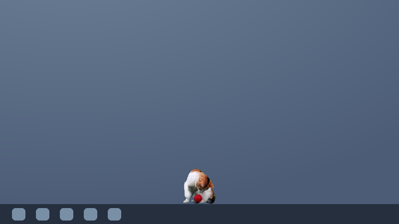
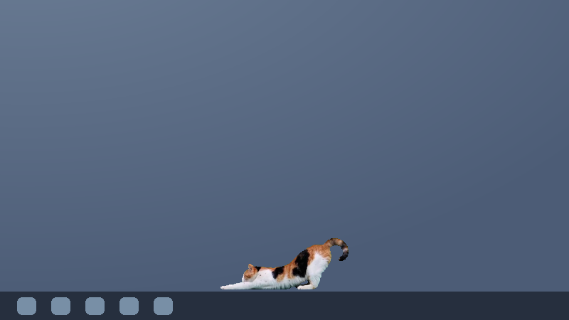
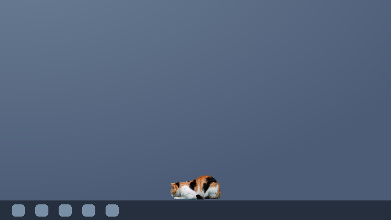
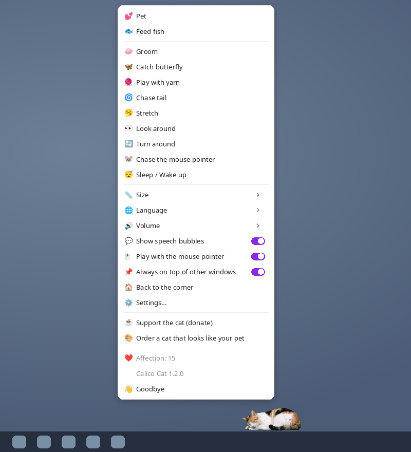
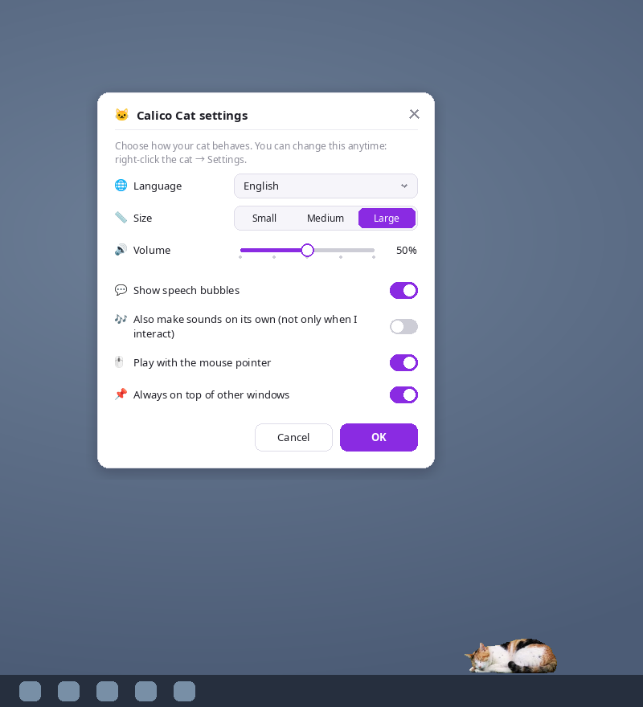

<div align="center">

# 🐱 Calico Cat — a realistic calico cat for your desktop

**English** · [Tiếng Việt](README.vi.md)

Version 1.3.0 · [Release notes](https://github.com/tunv201298/cat-desktop-pet/releases) · [Download](https://github.com/tunv201298/cat-desktop-pet/releases/latest) · [▶ Intro video](#screenshots-and-video)


A lifelike calico cat that lives at the bottom of your screen: it walks around, sits, grooms,
chases butterflies, plays with yarn, naps — and reacts when you pet it, pick it up or call it
from the menu. Every animation is cut from real (AI-generated) video, so it moves like a real cat.

</div>

---

## Contents

- [Features](#features)
- [Screenshots and video](#screenshots-and-video)
- [Supported systems](#supported-systems)
- [Installation](#installation)
- [First launch](#first-launch)
- [Usage](#usage)
- [Settings](#settings)
- [Known limitations](#known-limitations)
- [Troubleshooting](#troubleshooting)
- [Support the cat](#support-the-cat)
- [Custom cat](#custom-cat)
- [Uninstall](#uninstall)
- [License](#license)

## Features

- **Real-video animation** — walk cycle, sitting down, standing up, turning around, grooming,
  stretching, chasing its tail, catching butterflies, playing with yarn, sleeping. Smooth 24–48
  frames per second with seamless transitions between poses; paws never slide on the ground.
- **Lives on its own** — picks a random activity every few seconds, never in the same order twice.
- **Interactive** — click to pet, double-click and it chirps, drag to pick it up by the scruff,
  drop it and it lands on its feet. Wiggle the mouse pointer next to it and it may turn, pounce or
  give chase.
- **Stays out of your way** — only 41 px tall by default (three sizes), always on top or behind
  your windows as you prefer.
- **10 languages** — English (default), Tiếng Việt, 日本語, 中文, 한국어, Español, Français, Deutsch,
  Português, Русский. Speech bubbles can be turned off.
- **Real cat sounds** — meows, purrs and chirps at a soft, even volume, adjustable or muted.
- **Offline and private** — no network access; settings stay on your computer.

## Screenshots and video

**▶ Intro video** (1 min 17 s, no sound) — the real app, recorded on a plain desktop.

https://github.com/user-attachments/assets/464a1e31-83be-4b73-bc18-72bfb395a1d7

<table>
<tr><td align="center" width="33%"><br>Says hello</td><td align="center" width="33%"><br>Walks around</td><td align="center" width="33%"><br>Chases butterflies</td></tr>
<tr><td align="center" width="33%"><br>Click to pet</td><td align="center" width="33%"><br>Eats a fish</td><td align="center" width="33%"><br>Plays with yarn</td></tr>
<tr><td align="center" width="33%"><br>Drag to pick it up</td><td align="center" width="33%"><br>Stretches and yawns</td><td align="center" width="33%"><br>Takes naps</td></tr>
<tr><td align="center" width="33%"><br>Right-click menu</td><td align="center" width="33%"><br>Settings</td></tr>
</table>

## Supported systems

| System | Download | Notes |
|---|---|---|
| Windows 10 / 11 (64-bit) | `CalicoCat-<version>-Setup.exe` | The cat's outline is slightly jagged (see [Known limitations](#known-limitations)). |
| Ubuntu 22.04 or newer, Debian-based distributions (64-bit) | `calico-cat_<version>_amd64.deb` | Works on X11 and on Wayland (GNOME, KDE). |
| macOS 12 or newer, Apple Silicon (**beta**) | `CalicoCat-<version>-macOS.dmg` | Not yet tested on a real Mac. |

## Installation

Download the file for your system from the [latest release](https://github.com/tunv201298/cat-desktop-pet/releases/latest).

### Windows

1. Download **`CalicoCat-<version>-Setup.exe`** from the [latest release](https://github.com/tunv201298/cat-desktop-pet/releases/latest).
   If your browser says the file *isn't commonly downloaded*, choose **Keep** (in Edge: **…** →
   **Keep** → **Show more** → **Keep anyway**).
2. Double-click the file. Windows shows a blue **Windows protected your PC** window: click
   **More info**, then **Run anyway**. This is shown only once.
3. The installer installs for your user account only — no administrator rights needed (choose
   "all users" in the first dialog if you prefer). Leave **Launch Calico Cat** ticked on the last
   page, or start **Calico Cat** from the Start menu later.
4. The settings window opens first (language, size, sound…); click **OK** and the cat appears.
   You can change everything later: right-click the cat → **⚙️ Settings…**.

**Why does Windows warn, and is it safe?** Windows shows this window for every new app that is not
signed with a paid code-signing certificate (a few hundred dollars a year, too much for a free hobby
app). It is not a virus warning. Calico Cat:

- is only published on [this page](https://github.com/tunv201298/cat-desktop-pet/releases) — do not
  install copies from anywhere else;
- is built on GitHub's servers for every release; the release notes list the SHA-256 checksum of each
  file, so you can check that your download is the original (PowerShell:
  `Get-FileHash CalicoCat-<version>-Setup.exe`);
- needs no administrator rights, never connects to the internet and collects no data (opening the
  ☕ / 🎨 menu items only opens this page in your browser);
- uninstalls cleanly from *Settings → Apps* (see [Uninstall](#uninstall)).

### Ubuntu / Debian

Double-click the `.deb` file to install it with App Center, or run:

```bash
sudo apt install ./calico-cat_<version>_amd64.deb
```

Start **Calico Cat** from the applications menu.

### macOS (beta)

1. Open **`CalicoCat-<version>-macOS.dmg`** and drag **Calico Cat** into *Applications*.
2. The app is not signed by Apple, so the first launch is blocked: open *System Settings → Privacy &
   Security* and click **Open Anyway** next to Calico Cat.

## First launch

The first time Calico Cat starts, a settings window opens before the cat appears:

| Option | Choices |
|---|---|
| Language | English (default) and 9 other languages — the window switches language as soon as you pick one |
| Size | Small 41 px (default) · Medium 56 px · Large 85 px |
| Volume | 0 – 100% (default 50%); release the slider to hear a sample meow |
| Show speech bubbles | On (default) / off |
| Play with the mouse pointer | On (default) / off |
| Always on top of other windows | On (default) / off |
| Start with Windows | Off (default) / on — Windows only |

Click **OK** to save. Closing the window keeps the defaults. You can open it again any time:
right-click the cat → **⚙ Settings…**

## Usage

The cat appears in the bottom-right corner and starts living its life after a few seconds.

### Interacting with the cat

| Action | What happens |
|---|---|
| **Click** | Pet the cat — hearts float up, it meows and purrs, and its affection grows ❤ |
| **Double-click** | The cat chirps |
| **Click and drag** | Pick the cat up by the scruff — it dangles and swings under your cursor |
| **Release while holding** | The cat drops back to the ground, lands in a crouch and sits up |
| **Click while it sleeps** | Wakes it up |
| **Wiggle the pointer near the sitting cat** | It notices — turns around, pounces or chases the pointer for a moment |
| **Right-click** | Opens the menu |

**Lost the cat** (hidden behind a window, or off-screen)? Start Calico Cat again from the Start menu or
the applications menu: the running cat comes back to the corner and says hello. On Windows you can also
click the cat icon in the system tray (bottom right of the taskbar; right-click it for the menu). While a
game, video or presentation runs full screen, the cat hides and stays quiet (Windows).

### Menu

| Item | Description |
|---|---|
| 💕 Pet · 🐟 Feed fish | Pet or feed the cat (both increase affection) |
| 🧼 Groom · 🦋 Catch butterfly · 🧶 Play with yarn · 🌀 Chase tail · 🥱 Stretch · 👀 Look around · 🔄 Turn around | Start an activity right away |
| 🐭 Chase the mouse pointer | The cat follows your cursor for a few seconds |
| 😴 Sleep / Wake up | Puts the cat to sleep or wakes it up |
| 🪟 Go up onto a window / down | Windows only: the cat fades out, a small window appears on top of an open window, and the cat walks out of it and sits down (or goes back down the same way) |
| 📏 Size | Small 41 px · Medium 56 px · Large 85 px |
| 🌐 Language | Language of the speech bubbles and the menu |
| 💬 Show speech bubbles (switch) | Show or hide what the cat says |
| 🔊 Volume | Off · 25% · 50% · 75% · 100% for the cat sounds (meow, purr, trill, chatter, yawn…) |
| 🖱️ Play with the mouse pointer (switch) | Let the cat react when the pointer wiggles near it, or not |
| 📌 Always on top (switch) | Keep the cat above other windows, or let windows cover it |
| 🚀 Start with Windows (switch) | Launch automatically when you sign in (Windows only) |
| 🏠 Back to the corner | Moves the cat back to the bottom-right corner |
| 🙈 Hide the cat / 🐱 Show the cat | Windows only: hide the cat; click the tray icon to bring it back |
| ⚙ Settings… | Opens the settings window to change several options at once |
| ☕ Support the cat · 🎨 Order a cat that looks like your pet | Open the donation page or the request page in your browser |
| ❤ Affection | How much the cat likes you (read-only) |
| ❌ Goodbye | Quit |

### What the cat does on its own

| Activity | Share | Description |
|---|---|---|
| 🚶 Walk | 32% | Stands up, walks for 6–14 s, sits down. Often turns around first; near the screen edge it stops, looks back and walks the other way |
| 🪑 Sit | 13% | Rests and sometimes says something |
| 🧼 Groom | 11% | Licks its paw and washes its face |
| 🧶 Yarn | 9% | Pats, hugs and kicks a ball of yarn |
| 🦋 Butterfly | 7% | A butterfly flutters in; the cat stalks it and leaps — and just misses |
| 🥱 Stretch | 7% | Long stretch followed by a big yawn |
| 👀 Look around | 7% | Looks back over its shoulder |
| 🌀 Chase tail | 6% | Spins after its tail and gets dizzy |
| 😴 Sleep | 6% | Curls up and breathes slowly until you wake it |
| 🪟 Onto a window | Windows only | Goes up onto the top edge of an open (not maximised) window, walks and naps there, follows the window when you drag it and drops down when it closes |

## Settings

Every change from the menu or the settings window is saved right away and kept for the next
launch. Settings are stored in `%APPDATA%\CalicoCat` on Windows and in the `.calico_cat` folder
in your home folder on Ubuntu and macOS; delete that folder to reset everything and see the
first-launch window again.

By default the cat only makes sounds after you click it or pick something from the menu; tick
**Also make sounds on its own** in the settings window to hear it while it plays by itself.

The language item always also reads "Language", so you can find it even in a language you cannot read.

### Start automatically on Ubuntu

The **Start with Windows** option exists only on Windows. On Ubuntu, run once:

```bash
mkdir -p ~/.config/autostart && cp /usr/share/applications/calico-cat.desktop ~/.config/autostart/
```

To stop it, delete `~/.config/autostart/calico-cat.desktop`.

## Known limitations

- **Memory** — animations stay in memory so the cat reacts instantly: about 90 MB at Small size
  and about 240 MB at Large.
- **Windows** — transparency is on/off per pixel, so the cat's outline is slightly jagged instead
  of anti-aliased.
- **Ubuntu** — while the menu is open, a click outside it only closes the menu and does not reach
  the window below.
- **Multiple monitors** — on Windows the cat walks and lands on the bottom of whichever monitor it is
  on (drag it to another monitor to move it there). On Ubuntu and macOS it stays on the main screen.
- **Ubuntu on Wayland** — the cat only notices the mouse pointer while the pointer is over another
  X11 window or the cat itself, so *Play with the mouse pointer* rarely triggers there.

## Troubleshooting

| Problem | Solution |
|---|---|
| Windows: SmartScreen blocks the installer | Click **More info → Run anyway** (the installer is not code-signed) |
| Windows: the antivirus reports Calico Cat as a threat | A false alarm that unsigned apps sometimes get. Download only from the [official releases page](https://github.com/tunv201298/cat-desktop-pet/releases), and please [open an issue](https://github.com/tunv201298/cat-desktop-pet/issues) so it can be reported to the antivirus vendor |
| macOS: "Calico Cat cannot be opened" | *System Settings → Privacy & Security* → **Open Anyway** |
| Ubuntu: the cat does not appear | Make sure you are in a normal desktop session (GNOME, KDE…); on Wayland, XWayland must be available (it is by default) |
| The cat is hidden behind windows | Menu → 📌 Always on top |
| The cat is too big or too small | Menu → 📏 Size |
| No sound | Menu → 🔊 Volume, and check your system volume |
| The cat got lost off-screen or behind a window | Start Calico Cat again (or click its tray icon on Windows) — it comes back to the corner; or Menu → 🏠 Back to the corner |

Found a bug or have an idea? [Open an issue](https://github.com/tunv201298/cat-desktop-pet/issues).

## Support the cat

Calico Cat is free. If it makes your day a little nicer, you can help it grow:

- **Donate** — a pay-what-you-want page on itch.io is coming with the public release; the link will
  appear here.
- **Star** [this repository](https://github.com/tunv201298/cat-desktop-pet) and share the cat with friends.
- **Report bugs and ideas** in the [issues](https://github.com/tunv201298/cat-desktop-pet/issues).

## Custom cat

Want a desktop cat that looks like your own pet? Each custom cat is drawn from new animations made
from your photos and delivered as its own installer. [Send a request](https://github.com/tunv201298/cat-desktop-pet/issues/new?title=Custom%20cat%20request&body=%2A%2AMy%20pet%3A%2A%2A%20%28cat%20or%20dog%2C%20coat%20colours%20and%20markings%29%0A%0A%2A%2APhotos%3A%2A%2A%20%28attach%203%E2%80%935%20clear%20photos%3A%20side%20view%20sitting%2C%20side%20view%20standing%20or%20walking%2C%20face%29%0A%0A%2A%2ASystem%3A%2A%2A%20Windows%20/%20Ubuntu%20/%20macOS%0A%0A%2A%2AHow%20to%20reach%20me%20for%20the%20price%3A%2A%2A%20%28email%20or%20other%20contact%29)
with 3–5 clear photos of your pet; you get a price before any work starts. Issues are public — if
you would rather not share the photos publicly, say so in the request and leave a way to contact you.

## Uninstall

1. Ubuntu only: delete `~/.config/autostart/calico-cat.desktop` if you created it (on Windows the
   uninstaller also removes the start-up entry).
2. Uninstall from *Settings → Apps* (Windows), with `sudo apt remove calico-cat` (Ubuntu), or by
   moving Calico Cat from *Applications* to the Trash (macOS).
3. Delete the settings folder (see [Settings](#settings)).

## License

Calico Cat is free to use, at home and at work — see the [terms of use](LICENSE.txt). It includes
third-party software (Python, Tcl/Tk, Pillow) under their own licenses, listed in
`THIRD_PARTY_LICENSES.txt` next to the installed program.
