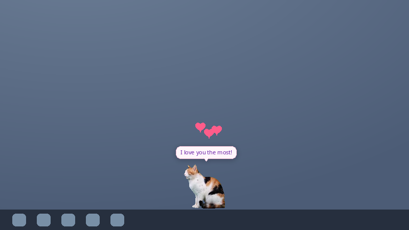
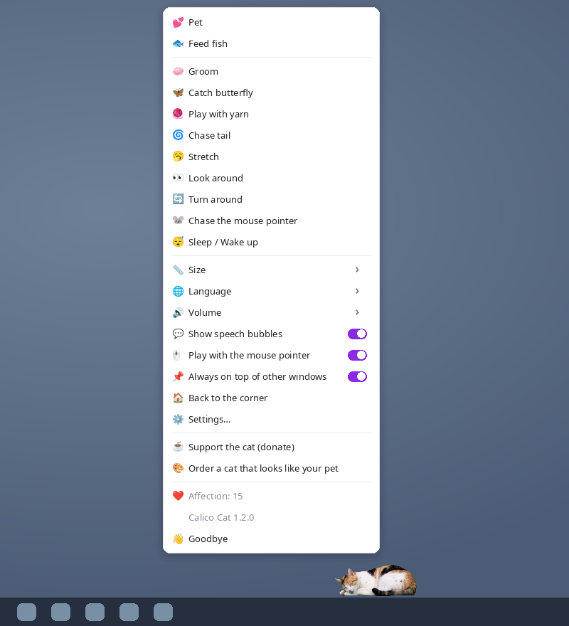

<div align="center">

# 🐱 Calico Cat — chú mèo tam thể sống động trên màn hình

[English](README.md) · **Tiếng Việt**

Phiên bản 1.0.1 · [Ghi chú phát hành](https://github.com/tunv201298/cat-desktop-pet/releases) · [Tải về](https://github.com/tunv201298/cat-desktop-pet/releases/latest) · [▶ Video giới thiệu](#ảnh-và-video)


Một chú mèo tam thể như thật sống ở mép dưới màn hình: tự đi dạo, ngồi nghỉ, liếm lông, bắt
bướm, chơi len, ngủ — và phản ứng khi bạn vuốt ve, nhấc lên hay gọi từ menu. Mọi hoạt ảnh đều
cắt từ video (tạo bằng AI), nên mèo chuyển động như mèo thật.

</div>

---

## Mục lục

- [Tính năng](#tính-năng)
- [Ảnh và video](#ảnh-và-video)
- [Hệ điều hành hỗ trợ](#hệ-điều-hành-hỗ-trợ)
- [Cài đặt](#cài-đặt)
- [Lần chạy đầu tiên](#lần-chạy-đầu-tiên)
- [Cách dùng](#cách-dùng)
- [Thiết lập](#thiết-lập)
- [Giới hạn đã biết](#giới-hạn-đã-biết)
- [Xử lý sự cố](#xử-lý-sự-cố)
- [Gỡ cài đặt](#gỡ-cài-đặt)
- [Giấy phép](#giấy-phép)

## Tính năng

- **Hoạt ảnh từ video thật** — đi bộ, ngồi xuống, đứng dậy, quay đầu, liếm lông, vươn vai, đuổi
  đuôi, bắt bướm, chơi len, ngủ. Mượt 24–48 khung/giây, chuyển dáng liền mạch, chân không trượt
  trên mặt đất.
- **Tự sinh hoạt** — vài giây lại chọn một hoạt động ngẫu nhiên, không lặp lại y hệt.
- **Tương tác** — click để vuốt ve, nhấn đúp để mèo nhảy, kéo để nhấc gáy mèo lên, thả ra là mèo
  rơi xuống tiếp đất.
- **Không vướng việc** — mặc định chỉ cao 51 px (có 3 cỡ), luôn nằm trên cùng hoặc nằm sau các
  cửa sổ tuỳ bạn chọn.
- **10 ngôn ngữ** — English (mặc định), Tiếng Việt, 日本語, 中文, 한국어, Español, Français, Deutsch,
  Português, Русский. Tắt được bong bóng lời thoại.
- **Tiếng mèo thật** — kêu meo, gừ gừ, kêu rừ… ở âm lượng nhỏ, đều nhau; chỉnh to nhỏ hoặc tắt được.
- **Không cần mạng, riêng tư** — không truy cập mạng; thiết lập chỉ lưu trên máy bạn.

## Ảnh và video

**▶ Video giới thiệu** (2 phút, có tiếng) — lần lượt mọi hoạt động của app thật.

https://github.com/user-attachments/assets/d3dd2594-0550-42e8-87d0-7f42f8c207b2

<table>
<tr><td align="center" width="33%"><br>Chào bạn</td><td align="center" width="33%"><br>Đi dạo</td><td align="center" width="33%"><br>Bắt bướm</td></tr>
<tr><td align="center" width="33%"><br>Click để vuốt ve</td><td align="center" width="33%"><br>Chơi bóng len</td><td align="center" width="33%"><br>Kéo để nhấc lên</td></tr>
<tr><td align="center" width="33%"><br>Vươn vai và ngáp</td><td align="center" width="33%"><br>Ngủ trưa</td><td align="center" width="33%"><br>Menu chuột phải</td></tr>
</table>

## Hệ điều hành hỗ trợ

| Hệ điều hành | File tải | Ghi chú |
|---|---|---|
| Windows 10 / 11 (64-bit) | `CalicoCat-<phiên bản>-Setup.exe` | Viền mèo hơi răng cưa (xem [Giới hạn đã biết](#giới-hạn-đã-biết)). |
| Ubuntu 22.04 trở lên, các bản Linux họ Debian (64-bit) | `calico-cat_<phiên bản>_amd64.deb` | Chạy được trên X11 và Wayland (GNOME, KDE). |
| macOS 12 trở lên, chip Apple Silicon (**thử nghiệm**) | `CalicoCat-<phiên bản>-macOS.dmg` | Chưa chạy thử trên máy Mac thật. |

## Cài đặt

Tải file cho hệ điều hành của bạn ở [bản phát hành mới nhất](https://github.com/tunv201298/cat-desktop-pet/releases/latest).

### Windows

1. Chạy **`CalicoCat-<phiên bản>-Setup.exe`**. Bộ cài chỉ cài cho tài khoản của bạn — không cần
   quyền quản trị (muốn cài cho mọi người dùng thì chọn "all users" ở hộp thoại đầu tiên).
2. Để nguyên ô **Launch Calico Cat** ở trang cuối, hoặc mở **Calico Cat** từ Start menu sau.

Windows SmartScreen có thể cảnh báo nhà phát hành không xác định vì bộ cài chưa ký số: bấm
**More info → Run anyway**.

### Ubuntu / Debian

Nhấn đúp file `.deb` để cài bằng App Center, hoặc chạy:

```bash
sudo apt install ./calico-cat_<phiên bản>_amd64.deb
```

Mở **Calico Cat** từ menu ứng dụng.

### macOS (thử nghiệm)

1. Mở **`CalicoCat-<phiên bản>-macOS.dmg`** và kéo **Calico Cat** vào *Applications*.
2. App chưa được Apple ký nên lần đầu mở sẽ bị chặn: vào *System Settings → Privacy & Security* và
   bấm **Open Anyway** cạnh Calico Cat.

## Lần chạy đầu tiên

Lần đầu mở Calico Cat, cửa sổ thiết lập hiện ra trước khi mèo bắt đầu hoạt động:

| Tuỳ chọn | Lựa chọn |
|---|---|
| Ngôn ngữ | English (mặc định) và 9 ngôn ngữ khác — chọn xong là cửa sổ đổi ngôn ngữ theo ngay |
| Kích thước | Nhỏ 51 px (mặc định) · Vừa 70 px · Lớn 106 px |
| Âm lượng | 0 – 100% (mặc định 50%); thả thanh trượt ra để nghe thử tiếng meo |
| Hiện bong bóng lời thoại | Bật (mặc định) / tắt |
| Luôn nằm trên các cửa sổ khác | Bật (mặc định) / tắt |
| Khởi động cùng Windows | Tắt (mặc định) / bật — chỉ có trên Windows |

Bấm **OK** để lưu. Đóng cửa sổ thì giữ mặc định. Mở lại bất cứ lúc nào: chuột phải vào mèo →
**⚙ Thiết lập…**

## Cách dùng

Mèo xuất hiện ở góc dưới bên phải màn hình và bắt đầu tự sinh hoạt sau vài giây.

### Tương tác với mèo

| Thao tác | Kết quả |
|---|---|
| **Click** | Vuốt ve — tim bay lên, mèo kêu meo rồi gừ gừ, độ thân thiết tăng ❤ |
| **Nhấn đúp** | Mèo nhảy lên |
| **Bấm giữ và kéo** | Nhấc gáy mèo lên — mèo treo lủng lẳng, đung đưa theo con trỏ |
| **Thả chuột khi đang nhấc** | Mèo rơi xuống đất và tiếp đất nhún nhẹ |
| **Click khi mèo đang ngủ** | Đánh thức mèo |
| **Chuột phải** | Mở menu |

### Menu

| Mục | Mô tả |
|---|---|
| ✖ Đóng menu | Đóng menu (click ra ngoài menu cũng được) |
| 💕 Vuốt ve · 🐟 Cho ăn cá | Vuốt ve hoặc cho mèo ăn (đều tăng độ thân thiết) |
| 🧼 Liếm lông · 🦋 Bắt bướm · 🧶 Chơi bóng len · 🌀 Đuổi đuôi · 🥱 Vươn vai · 👀 Ngó quanh · 🔄 Quay người | Cho mèo làm ngay hoạt động đó |
| 🐭 Đuổi theo con trỏ chuột | Mèo chạy theo con trỏ trong vài giây |
| 😴 Đi ngủ / Thức dậy | Cho mèo ngủ hoặc đánh thức |
| 📏 Kích thước | Nhỏ 51 px · Vừa 70 px · Lớn 106 px |
| 🌐 Ngôn ngữ | Ngôn ngữ của lời thoại và menu |
| 💬 Lời thoại | Hiện hoặc ẩn bong bóng lời thoại |
| 🔊 Âm lượng | Tắt · 25% · 50% · 75% · 100% cho tiếng mèo (meo, gừ gừ, kêu rừ, ngáp…) |
| 📌 Luôn ở trên cùng | Mèo luôn nằm trên mọi cửa sổ, hoặc để cửa sổ khác che |
| 🚀 Khởi động cùng Windows | Tự chạy khi đăng nhập (chỉ Windows) |
| 🏠 Về góc phải màn hình | Đưa mèo về góc dưới bên phải |
| ⚙ Thiết lập… | Mở cửa sổ thiết lập để đổi nhiều tuỳ chọn một lúc |
| ❤ Độ thân thiết | Mèo quý bạn tới đâu (chỉ để xem) |
| ❌ Tạm biệt meo | Thoát |

### Mèo tự làm gì

| Hoạt động | Tỉ lệ | Mô tả |
|---|---|---|
| 🚶 Đi dạo | 32% | Đứng dậy, đi 6–14 giây, ngồi xuống. Hay xoay người trước khi đi; gần mép màn hình thì dừng, ngoái lại rồi quay người đi ngược lại |
| 🪑 Ngồi nghỉ | 13% | Ngồi nghỉ, thỉnh thoảng nói một câu |
| 🧼 Liếm lông | 11% | Liếm chân rồi rửa mặt |
| 🧶 Chơi len | 9% | Vờn, ôm và đạp cuộn len |
| 🦋 Bắt bướm | 7% | Bướm bay tới; mèo rình rồi nhảy vồ — và suýt bắt được |
| 🥱 Vươn vai | 7% | Vươn dài người rồi ngáp to |
| 👀 Ngó quanh | 7% | Ngoái đầu nhìn ra sau |
| 🌀 Đuổi đuôi | 6% | Xoay vòng đuổi đuôi tới chóng mặt |
| 😴 Ngủ | 6% | Cuộn tròn thở đều tới khi bạn đánh thức |

## Thiết lập

Mọi thay đổi trong menu hoặc cửa sổ thiết lập được lưu ngay và giữ cho lần mở sau. Thiết lập nằm
trong thư mục `.calico_cat` ở thư mục người dùng (Windows: `C:\Users\<tên bạn>\.calico_cat`); xoá
thư mục này để đưa mọi thứ về mặc định và thấy lại cửa sổ thiết lập lần đầu.

Mục ngôn ngữ luôn kèm chữ "Language", để ai không đọc được ngôn ngữ đang chọn vẫn tìm ra chỗ đổi.

### Tự chạy khi đăng nhập trên Ubuntu

Tuỳ chọn **Khởi động cùng Windows** chỉ có trên Windows. Trên Ubuntu, chạy một lần:

```bash
mkdir -p ~/.config/autostart && cp /usr/share/applications/calico-cat.desktop ~/.config/autostart/
```

Muốn tắt thì xoá file `~/.config/autostart/calico-cat.desktop`.

## Giới hạn đã biết

- **Bộ nhớ** — hoạt ảnh được giữ sẵn trong RAM để mèo phản ứng tức thì: khoảng 110 MB ở cỡ Nhỏ,
  khoảng 410 MB ở cỡ Lớn.
- **Windows** — trong suốt kiểu bật/tắt từng điểm ảnh nên viền mèo hơi răng cưa, không mịn.
- **Ubuntu** — khi menu đang mở, click ra ngoài chỉ đóng menu, không truyền xuống cửa sổ bên dưới.
- **Nhiều màn hình** — trên Windows, mèo đi và tiếp đất ở đáy của màn hình đang chứa nó (kéo mèo
  sang màn hình khác để chuyển). Trên Ubuntu và macOS, mèo chỉ ở màn hình chính.

## Xử lý sự cố

| Vấn đề | Cách xử lý |
|---|---|
| Windows: SmartScreen chặn bộ cài | Bấm **More info → Run anyway** (bộ cài chưa ký số) |
| Windows: phần mềm diệt virus báo Calico Cat là mối đe doạ | Báo nhầm, app chưa ký số đôi khi bị vậy. Chỉ tải từ [trang phát hành chính thức](https://github.com/tunv201298/cat-desktop-pet/releases) và [tạo issue](https://github.com/tunv201298/cat-desktop-pet/issues) để báo lại với hãng diệt virus |
| macOS: báo "Calico Cat cannot be opened" | *System Settings → Privacy & Security* → **Open Anyway** |
| Ubuntu: mèo không hiện | Kiểm tra đang ở phiên desktop bình thường (GNOME, KDE…); trên Wayland cần có XWayland (mặc định có sẵn) |
| Mèo bị cửa sổ khác che | Menu → 📌 Luôn ở trên cùng |
| Mèo quá to hoặc quá nhỏ | Menu → 📏 Kích thước |
| Không nghe tiếng | Menu → 🔊 Âm lượng, và kiểm tra âm lượng của máy |
| Mèo chạy mất khỏi màn hình | Menu → 🏠 Về góc phải màn hình, hoặc xoá thư mục `.calico_cat` |

Gặp lỗi hoặc có góp ý? [Tạo issue](https://github.com/tunv201298/cat-desktop-pet/issues).

## Gỡ cài đặt

1. Riêng Ubuntu: xoá `~/.config/autostart/calico-cat.desktop` nếu đã tạo (trên Windows, trình gỡ
   cài đặt tự xoá luôn mục khởi động cùng Windows).
2. Gỡ trong *Settings → Apps* (Windows), bằng `sudo apt remove calico-cat` (Ubuntu), hoặc kéo
   Calico Cat từ *Applications* vào Thùng rác (macOS).
3. Xoá thư mục `.calico_cat` trong thư mục người dùng.

## Giấy phép

Calico Cat được dùng miễn phí, ở nhà lẫn ở chỗ làm — xem [điều khoản sử dụng](LICENSE.txt) (tiếng Anh).
App có kèm phần mềm của bên thứ ba (Python, Tcl/Tk, Pillow) theo giấy phép riêng của từng phần mềm,
liệt kê trong file `THIRD_PARTY_LICENSES.txt` cạnh chương trình đã cài.
