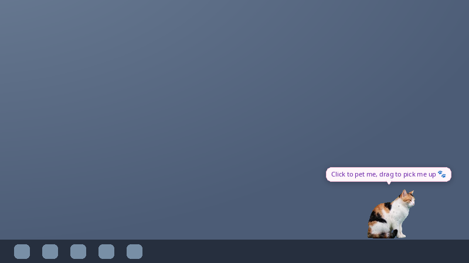
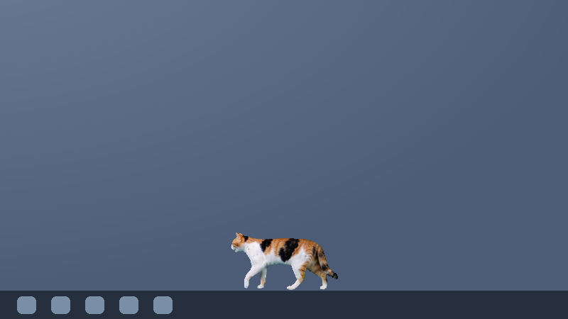
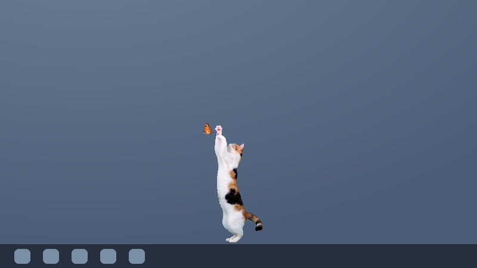
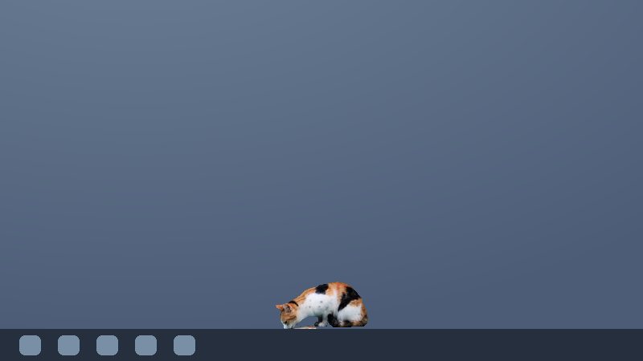
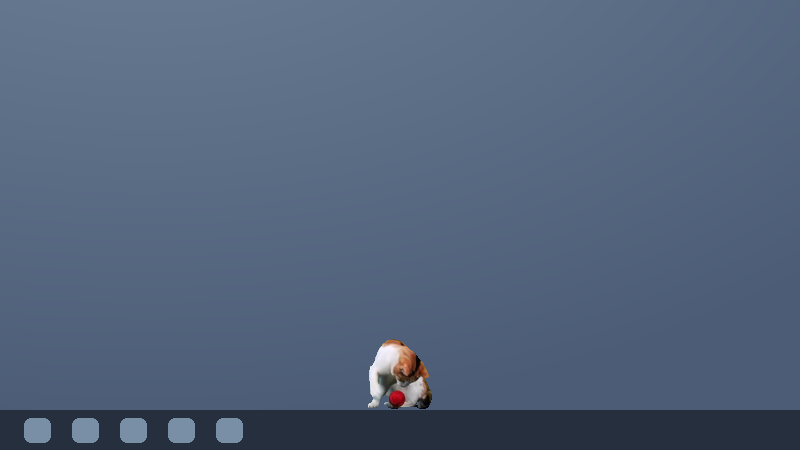
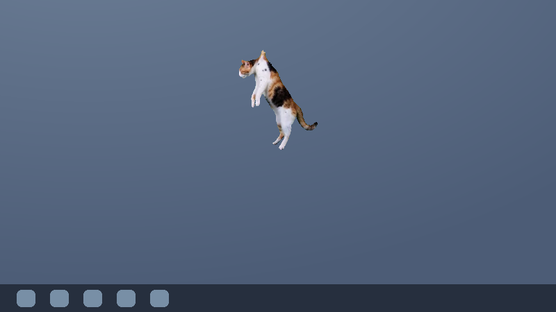
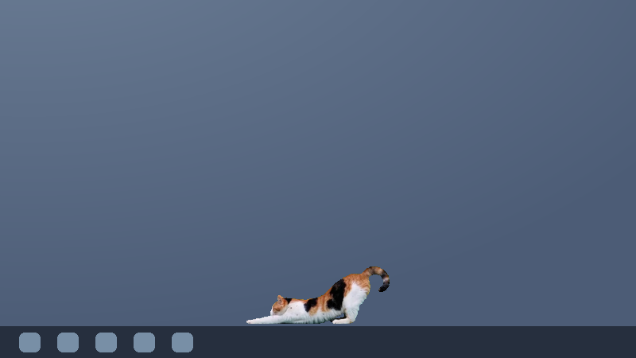
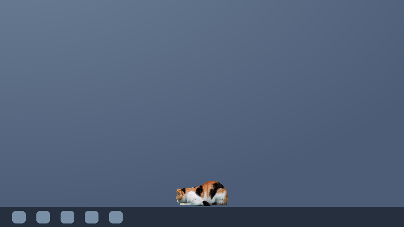
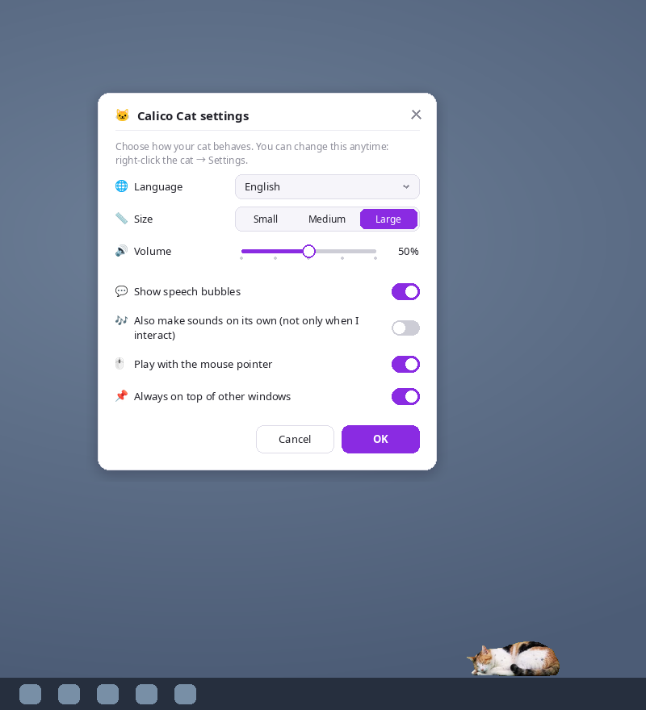

<div align="center">

# 🐱 Calico Cat — chú mèo tam thể sống động trên màn hình

[English](README.md) · **Tiếng Việt**

Phiên bản 1.3.0 · [Ghi chú phát hành](https://github.com/tunv201298/cat-desktop-pet/releases) · [Tải về](https://github.com/tunv201298/cat-desktop-pet/releases/latest) · [▶ Video giới thiệu](#ảnh-và-video)


Một chú mèo tam thể như thật sống ở mép dưới màn hình: tự đi dạo, ngồi nghỉ, liếm lông, bắt
bướm, chơi len, ngủ — và phản ứng khi bạn vuốt ve, nhấc lên hay gọi từ menu. Mọi hoạt ảnh đều
cắt từ video (tạo bằng AI), nên mèo chuyển động như mèo thật.

</div>

---

## Mục lục

- [Tính năng](#tính-năng)
- [Ảnh và video](#ảnh-và-video)
- [Hệ điều hành hỗ trợ](#hệ-điều-hành-hỗ-trợ)
- [Cài đặt](#cài-đặt)
- [Lần chạy đầu tiên](#lần-chạy-đầu-tiên)
- [Cách dùng](#cách-dùng)
- [Thiết lập](#thiết-lập)
- [Giới hạn đã biết](#giới-hạn-đã-biết)
- [Xử lý sự cố](#xử-lý-sự-cố)
- [Ủng hộ tác giả](#support)
- [Đặt làm mèo giống thú cưng của bạn](#custom-cat)
- [Gỡ cài đặt](#gỡ-cài-đặt)
- [Giấy phép](#giấy-phép)

## Tính năng

- **Hoạt ảnh từ video thật** — đi bộ, ngồi xuống, đứng dậy, quay đầu, liếm lông, vươn vai, đuổi
  đuôi, bắt bướm, chơi len, ngủ. Mượt 24–48 khung/giây, chuyển dáng liền mạch, chân không trượt
  trên mặt đất.
- **Tự sinh hoạt** — vài giây lại chọn một hoạt động ngẫu nhiên, không lặp lại y hệt.
- **Tương tác** — click để vuốt ve, nhấn đúp để mèo kêu, kéo để nhấc gáy mèo lên, thả ra là mèo
  rơi xuống tiếp đất. Lắc con trỏ chuột cạnh mèo là mèo có thể quay lại nhìn, vồ hoặc đuổi theo.
- **Không vướng việc** — mặc định chỉ cao 41 px (có 3 cỡ), luôn nằm trên cùng hoặc nằm sau các
  cửa sổ tuỳ bạn chọn.
- **10 ngôn ngữ** — English (mặc định), Tiếng Việt, 日本語, 中文, 한국어, Español, Français, Deutsch,
  Português, Русский. Tắt được bong bóng lời thoại.
- **Tiếng mèo thật** — kêu meo, gừ gừ, kêu rừ… ở âm lượng nhỏ, đều nhau; chỉnh to nhỏ hoặc tắt được.
- **Không cần mạng, riêng tư** — không truy cập mạng; thiết lập chỉ lưu trên máy bạn.

## Ảnh và video

**▶ Video giới thiệu** (1 phút 17 giây, không tiếng) — app thật, quay trên một màn hình trống.

https://github.com/user-attachments/assets/464a1e31-83be-4b73-bc18-72bfb395a1d7

<table>
<tr><td align="center" width="33%"><br>Chào bạn</td><td align="center" width="33%"><br>Đi dạo</td><td align="center" width="33%"><br>Bắt bướm</td></tr>
<tr><td align="center" width="33%"><br>Click để vuốt ve</td><td align="center" width="33%"><br>Ăn cá</td><td align="center" width="33%"><br>Chơi bóng len</td></tr>
<tr><td align="center" width="33%"><br>Kéo để nhấc lên</td><td align="center" width="33%"><br>Vươn vai và ngáp</td><td align="center" width="33%"><br>Ngủ trưa</td></tr>
<tr><td align="center" width="33%"><br>Menu chuột phải</td><td align="center" width="33%"><br>Thiết lập</td></tr>
</table>

## Hệ điều hành hỗ trợ

| Hệ điều hành | File tải | Ghi chú |
|---|---|---|
| Windows 10 / 11 (64-bit) | `CalicoCat-<phiên bản>-Setup.exe` | Viền mèo hơi răng cưa (xem [Giới hạn đã biết](#giới-hạn-đã-biết)). |
| Ubuntu 22.04 trở lên, các bản Linux họ Debian (64-bit) | `calico-cat_<phiên bản>_amd64.deb` | Chạy được trên X11 và Wayland (GNOME, KDE). |
| macOS 12 trở lên, chip Apple Silicon (**thử nghiệm**) | `CalicoCat-<phiên bản>-macOS.dmg` | Chưa chạy thử trên máy Mac thật. |

## Cài đặt

Tải file cho hệ điều hành của bạn ở [bản phát hành mới nhất](https://github.com/tunv201298/cat-desktop-pet/releases/latest).

### Windows

1. Tải **`CalicoCat-<phiên bản>-Setup.exe`** ở [bản phát hành mới nhất](https://github.com/tunv201298/cat-desktop-pet/releases/latest).
   Nếu trình duyệt báo file *không thường được tải về*, chọn **Keep** (trên Edge: **…** →
   **Keep** → **Show more** → **Keep anyway**).
2. Nhấn đúp vào file. Windows hiện khung xanh **Windows protected your PC**: bấm **More info**, rồi
   **Run anyway**. Chỉ hiện một lần.
3. Bộ cài chỉ cài cho tài khoản của bạn — không cần quyền quản trị (muốn cài cho mọi người dùng thì
   chọn "all users" ở hộp thoại đầu tiên). Để nguyên ô **Launch Calico Cat** ở trang cuối, hoặc mở
   **Calico Cat** từ Start menu sau.
4. Cửa sổ thiết lập mở ra trước (ngôn ngữ, kích thước, âm thanh…); bấm **OK** là mèo xuất hiện. Đổi
   lại lúc nào cũng được: chuột phải vào mèo → **⚙️ Thiết lập…**.

**Vì sao Windows cảnh báo, có an toàn không?** Windows hiện khung này với mọi app mới chưa được ký bằng
chứng chỉ ký số trả phí (vài trăm USD mỗi năm, quá đắt với một app miễn phí làm vì sở thích). Đây không
phải cảnh báo có virus. Calico Cat:

- chỉ được phát hành ở [trang này](https://github.com/tunv201298/cat-desktop-pet/releases) — đừng cài
  bản lấy từ nơi khác;
- được build trên máy chủ của GitHub cho mỗi bản phát hành; ghi chú phát hành có mã SHA-256 của từng
  file để bạn kiểm tra file tải về đúng là file gốc (PowerShell:
  `Get-FileHash CalicoCat-<phiên bản>-Setup.exe`);
- không cần quyền quản trị, không kết nối internet, không thu thập dữ liệu (mục ☕ / 🎨 trong menu chỉ
  mở trang này trong trình duyệt);
- gỡ sạch trong *Settings → Apps* (xem [Gỡ cài đặt](#gỡ-cài-đặt)).

### Ubuntu / Debian

Nhấn đúp file `.deb` để cài bằng App Center, hoặc chạy:

```bash
sudo apt install ./calico-cat_<phiên bản>_amd64.deb
```

Mở **Calico Cat** từ menu ứng dụng.

### macOS (thử nghiệm)

1. Mở **`CalicoCat-<phiên bản>-macOS.dmg`** và kéo **Calico Cat** vào *Applications*.
2. App chưa được Apple ký nên lần đầu mở sẽ bị chặn: vào *System Settings → Privacy & Security* và
   bấm **Open Anyway** cạnh Calico Cat.

## Lần chạy đầu tiên

Lần đầu mở Calico Cat, cửa sổ thiết lập hiện ra trước khi mèo bắt đầu hoạt động:

| Tuỳ chọn | Lựa chọn |
|---|---|
| Ngôn ngữ | English (mặc định) và 9 ngôn ngữ khác — chọn xong là cửa sổ đổi ngôn ngữ theo ngay |
| Kích thước | Nhỏ 41 px (mặc định) · Vừa 56 px · Lớn 85 px |
| Âm lượng | 0 – 100% (mặc định 50%); thả thanh trượt ra để nghe thử tiếng meo |
| Hiện bong bóng lời thoại | Bật (mặc định) / tắt |
| Vờn con trỏ chuột | Bật (mặc định) / tắt |
| Luôn nằm trên các cửa sổ khác | Bật (mặc định) / tắt |
| Khởi động cùng Windows | Tắt (mặc định) / bật — chỉ có trên Windows |

Bấm **OK** để lưu. Đóng cửa sổ thì giữ mặc định. Mở lại bất cứ lúc nào: chuột phải vào mèo →
**⚙ Thiết lập…**

## Cách dùng

Mèo xuất hiện ở góc dưới bên phải màn hình và bắt đầu tự sinh hoạt sau vài giây.

### Tương tác với mèo

| Thao tác | Kết quả |
|---|---|
| **Click** | Vuốt ve — tim bay lên, mèo kêu meo rồi gừ gừ, độ thân thiết tăng ❤ |
| **Nhấn đúp** | Mèo kêu một tiếng |
| **Bấm giữ và kéo** | Nhấc gáy mèo lên — mèo treo lủng lẳng, đung đưa theo con trỏ |
| **Thả chuột khi đang nhấc** | Mèo rơi xuống đất, tiếp đất khom người rồi ngồi dậy |
| **Click khi mèo đang ngủ** | Đánh thức mèo |
| **Lắc con trỏ cạnh mèo đang ngồi** | Mèo để ý — quay lại nhìn, vồ hoặc đuổi theo con trỏ một lúc |
| **Chuột phải** | Mở menu |

**Không thấy mèo đâu** (bị cửa sổ che, hoặc chạy khỏi màn hình)? Mở lại Calico Cat từ Start menu hoặc menu
ứng dụng: con mèo đang chạy sẽ về góc màn hình và chào bạn. Trên Windows còn có thể bấm biểu tượng mèo ở
khay hệ thống (góc phải thanh tác vụ; chuột phải vào đó để mở menu). Khi game, video hay trình chiếu đang
chạy toàn màn hình, mèo tự ẩn và im lặng (Windows).

### Menu

| Mục | Mô tả |
|---|---|
| 💕 Vuốt ve · 🐟 Cho ăn cá | Vuốt ve hoặc cho mèo ăn (đều tăng độ thân thiết) |
| 🧼 Liếm lông · 🦋 Bắt bướm · 🧶 Chơi bóng len · 🌀 Đuổi đuôi · 🥱 Vươn vai · 👀 Ngó quanh · 🔄 Quay người | Cho mèo làm ngay hoạt động đó |
| 🐭 Đuổi theo con trỏ chuột | Mèo chạy theo con trỏ trong vài giây |
| 🖱 Vờn con trỏ chuột | Bật/tắt việc mèo phản ứng khi con trỏ lắc lư gần nó |
| 😴 Đi ngủ / Thức dậy | Cho mèo ngủ hoặc đánh thức |
| 🪟 Lên cửa sổ / xuống | Chỉ Windows: mèo mờ dần, trên nóc một cửa sổ đang mở hiện ra một ô cửa sổ nhỏ, mèo bước ra rồi ngồi xuống (xuống lại cũng vậy) |
| 📏 Kích thước | Nhỏ 41 px · Vừa 56 px · Lớn 85 px |
| 🌐 Ngôn ngữ | Ngôn ngữ của lời thoại và menu |
| 💬 Lời thoại | Hiện hoặc ẩn bong bóng lời thoại |
| 🔊 Âm lượng | Tắt · 25% · 50% · 75% · 100% cho tiếng mèo (meo, gừ gừ, kêu rừ, ngáp…) |
| 📌 Luôn ở trên cùng | Mèo luôn nằm trên mọi cửa sổ, hoặc để cửa sổ khác che |
| 🚀 Khởi động cùng Windows | Tự chạy khi đăng nhập (chỉ Windows) |
| 🏠 Về góc phải màn hình | Đưa mèo về góc dưới bên phải |
| 🙈 Ẩn mèo / 🐱 Hiện mèo | Chỉ Windows: ẩn mèo; bấm biểu tượng ở khay hệ thống để gọi lại |
| ⚙ Thiết lập… | Mở cửa sổ thiết lập để đổi nhiều tuỳ chọn một lúc |
| ☕ Ủng hộ tác giả · 🎨 Đặt làm mèo giống thú cưng của bạn | Mở trang ủng hộ hoặc trang gửi yêu cầu trong trình duyệt |
| ❤ Độ thân thiết | Mèo quý bạn tới đâu (chỉ để xem) |
| ❌ Tạm biệt meo | Thoát |

### Mèo tự làm gì

| Hoạt động | Tỉ lệ | Mô tả |
|---|---|---|
| 🚶 Đi dạo | 32% | Đứng dậy, đi 6–14 giây, ngồi xuống. Hay xoay người trước khi đi; gần mép màn hình thì dừng, ngoái lại rồi quay người đi ngược lại |
| 🪑 Ngồi nghỉ | 13% | Ngồi nghỉ, thỉnh thoảng nói một câu |
| 🧼 Liếm lông | 11% | Liếm chân rồi rửa mặt |
| 🧶 Chơi len | 9% | Vờn, ôm và đạp cuộn len |
| 🦋 Bắt bướm | 7% | Bướm bay tới; mèo rình rồi nhảy vồ — và suýt bắt được |
| 🥱 Vươn vai | 7% | Vươn dài người rồi ngáp to |
| 👀 Ngó quanh | 7% | Ngoái đầu nhìn ra sau |
| 🌀 Đuổi đuôi | 6% | Xoay vòng đuổi đuôi tới chóng mặt |
| 😴 Ngủ | 6% | Cuộn tròn thở đều tới khi bạn đánh thức |
| 🪟 Lên cửa sổ | Chỉ Windows | Lên nóc một cửa sổ đang mở (không phóng to), đi lại và ngủ trên đó, đi theo khi bạn kéo cửa sổ, rơi xuống khi cửa sổ đóng |

## Thiết lập

Mọi thay đổi trong menu hoặc cửa sổ thiết lập được lưu ngay và giữ cho lần mở sau. Thiết lập nằm
ở `%APPDATA%\CalicoCat` trên Windows, và trong thư mục `.calico_cat` ở thư mục người dùng trên
Ubuntu, macOS; xoá thư mục này để đưa mọi thứ về mặc định và thấy lại cửa sổ thiết lập lần đầu.

Mặc định mèo chỉ kêu sau khi bạn click hoặc chọn một mục trong menu; tick **Kêu cả khi tự chơi**
trong cửa sổ thiết lập để nghe cả lúc mèo tự chơi.

Mục ngôn ngữ luôn kèm chữ "Language", để ai không đọc được ngôn ngữ đang chọn vẫn tìm ra chỗ đổi.

### Tự chạy khi đăng nhập trên Ubuntu

Tuỳ chọn **Khởi động cùng Windows** chỉ có trên Windows. Trên Ubuntu, chạy một lần:

```bash
mkdir -p ~/.config/autostart && cp /usr/share/applications/calico-cat.desktop ~/.config/autostart/
```

Muốn tắt thì xoá file `~/.config/autostart/calico-cat.desktop`.

## Giới hạn đã biết

- **Bộ nhớ** — hoạt ảnh được giữ sẵn trong RAM để mèo phản ứng tức thì: khoảng 90 MB ở cỡ Nhỏ,
  khoảng 240 MB ở cỡ Lớn.
- **Windows** — trong suốt kiểu bật/tắt từng điểm ảnh nên viền mèo hơi răng cưa, không mịn.
- **Ubuntu** — khi menu đang mở, click ra ngoài chỉ đóng menu, không truyền xuống cửa sổ bên dưới.
- **Nhiều màn hình** — trên Windows, mèo đi và tiếp đất ở đáy của màn hình đang chứa nó (kéo mèo
  sang màn hình khác để chuyển). Trên Ubuntu và macOS, mèo chỉ ở màn hình chính.
- **Ubuntu dùng Wayland** — mèo chỉ thấy con trỏ chuột khi con trỏ nằm trên cửa sổ X11 khác hoặc trên
  chính mèo, nên *Vờn con trỏ chuột* hiếm khi xảy ra.

## Xử lý sự cố

| Vấn đề | Cách xử lý |
|---|---|
| Windows: SmartScreen chặn bộ cài | Bấm **More info → Run anyway** (bộ cài chưa ký số) |
| Windows: phần mềm diệt virus báo Calico Cat là mối đe doạ | Báo nhầm, app chưa ký số đôi khi bị vậy. Chỉ tải từ [trang phát hành chính thức](https://github.com/tunv201298/cat-desktop-pet/releases) và [tạo issue](https://github.com/tunv201298/cat-desktop-pet/issues) để báo lại với hãng diệt virus |
| macOS: báo "Calico Cat cannot be opened" | *System Settings → Privacy & Security* → **Open Anyway** |
| Ubuntu: mèo không hiện | Kiểm tra đang ở phiên desktop bình thường (GNOME, KDE…); trên Wayland cần có XWayland (mặc định có sẵn) |
| Mèo bị cửa sổ khác che | Menu → 📌 Luôn ở trên cùng |
| Mèo quá to hoặc quá nhỏ | Menu → 📏 Kích thước |
| Không nghe tiếng | Menu → 🔊 Âm lượng, và kiểm tra âm lượng của máy |
| Mèo chạy mất khỏi màn hình hoặc bị cửa sổ che | Mở lại Calico Cat (hoặc bấm biểu tượng ở khay hệ thống trên Windows) — mèo về góc màn hình; hoặc Menu → 🏠 Về góc phải màn hình |

Gặp lỗi hoặc có góp ý? [Tạo issue](https://github.com/tunv201298/cat-desktop-pet/issues).

<a id="support"></a>
## Ủng hộ tác giả

Calico Cat miễn phí. Nếu chú mèo làm ngày của bạn vui hơn một chút, bạn có thể giúp nó lớn lên:

- **Ủng hộ** — trang itch.io (trả bao nhiêu tuỳ bạn) sẽ có khi phát hành chính thức; link sẽ được
  thêm vào đây.
- **Gắn sao** [repository này](https://github.com/tunv201298/cat-desktop-pet) và giới thiệu chú mèo cho bạn bè.
- **Báo lỗi, góp ý** ở mục [issues](https://github.com/tunv201298/cat-desktop-pet/issues).

<a id="custom-cat"></a>
## Đặt làm mèo giống thú cưng của bạn

Muốn một chú mèo trên màn hình giống hệt thú cưng của mình? Mỗi bản đặt riêng được làm hoạt ảnh mới từ
ảnh của bạn và giao thành một bộ cài riêng. [Gửi yêu cầu](https://github.com/tunv201298/cat-desktop-pet/issues/new?title=%C4%90%E1%BA%B7t%20l%C3%A0m%20m%C3%A8o%20ri%C3%AAng&body=%2A%2ATh%C3%BA%20c%C6%B0ng%20c%E1%BB%A7a%20t%C3%B4i%3A%2A%2A%20%28m%C3%A8o%20hay%20ch%C3%B3%2C%20m%C3%A0u%20l%C3%B4ng%20v%C3%A0%20v%E1%BA%B1n%29%0A%0A%2A%2A%E1%BA%A2nh%3A%2A%2A%20%28%C4%91%C3%ADnh%20k%C3%A8m%203%E2%80%935%20%E1%BA%A3nh%20r%C3%B5%3A%20nh%C3%ACn%20ngang%20l%C3%BAc%20ng%E1%BB%93i%2C%20nh%C3%ACn%20ngang%20l%C3%BAc%20%C4%91%E1%BB%A9ng%20ho%E1%BA%B7c%20%C4%91i%2C%20khu%C3%B4n%20m%E1%BA%B7t%29%0A%0A%2A%2AH%E1%BB%87%20%C4%91i%E1%BB%81u%20h%C3%A0nh%3A%2A%2A%20Windows%20/%20Ubuntu%20/%20macOS%0A%0A%2A%2AC%C3%A1ch%20li%C3%AAn%20h%E1%BB%87%20%C4%91%E1%BB%83%20b%C3%A1o%20gi%C3%A1%3A%2A%2A%20%28email%20ho%E1%BA%B7c%20c%C3%A1ch%20kh%C3%A1c%29) kèm
3–5 ảnh rõ của thú cưng; bạn nhận báo giá trước khi bắt đầu làm. Issue là công khai — nếu không muốn
công khai ảnh, hãy ghi rõ trong yêu cầu và để lại cách liên hệ.

## Gỡ cài đặt

1. Riêng Ubuntu: xoá `~/.config/autostart/calico-cat.desktop` nếu đã tạo (trên Windows, trình gỡ
   cài đặt tự xoá luôn mục khởi động cùng Windows).
2. Gỡ trong *Settings → Apps* (Windows), bằng `sudo apt remove calico-cat` (Ubuntu), hoặc kéo
   Calico Cat từ *Applications* vào Thùng rác (macOS).
3. Xoá thư mục thiết lập (xem [Thiết lập](#thiết-lập)).

## Giấy phép

Calico Cat được dùng miễn phí, ở nhà lẫn ở chỗ làm — xem [điều khoản sử dụng](LICENSE.txt) (tiếng Anh).
App có kèm phần mềm của bên thứ ba (Python, Tcl/Tk, Pillow) theo giấy phép riêng của từng phần mềm,
liệt kê trong file `THIRD_PARTY_LICENSES.txt` cạnh chương trình đã cài.
